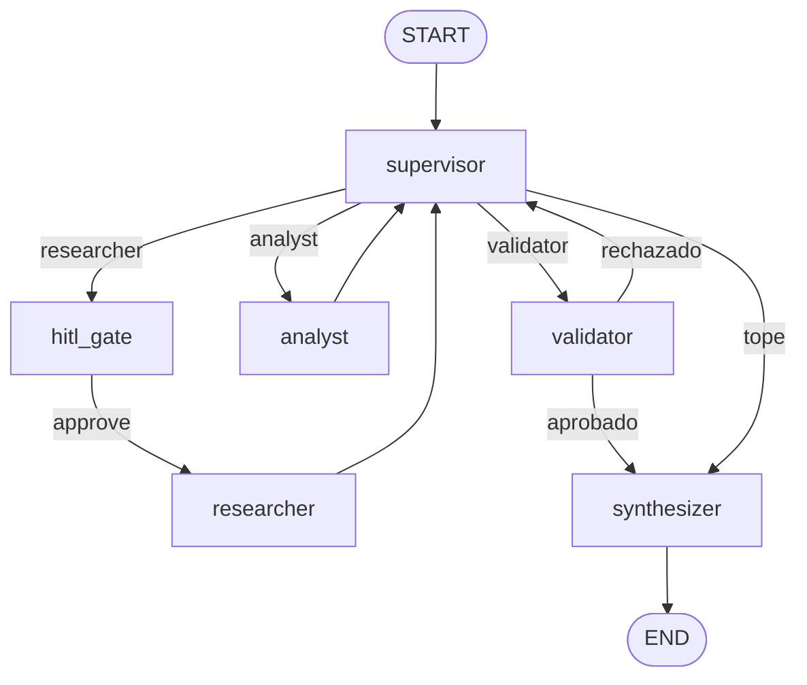

# Entrega 7 | API FastAPI asíncrona, Redis, HITL y observabilidad

API REST (FastAPI) sobre el orquestador multi-agente del módulo 6: encola tareas, persiste estado y checkpoints en Redis, pausa investigación con human-in-the-loop, y emite trazas a LangSmith (default) o Phoenix.

## Grafo



`hitl_gate` interrumpe antes de `web_search` (Tavily). `POST /tasks/{id}/approve` reanuda el hilo.

## Requisitos

- Python 3.12 (`pyproject.toml`: `>=3.12,<3.13`)
- Redis Stack (RediSearch) para `AsyncRedisSaver`
- `TAVILY_API_KEY` y una key de chat (`OPENAI_API_KEY` por defecto)
- Para LangSmith: `LANGSMITH_API_KEY`

## Setup local

```bash
cd deliveries/delivery7
python3.12 -m venv .venv
source .venv/bin/activate
python -m pip install --upgrade pip
python -m pip install .
pip install -r requirements.txt
cp .env.dist .env   # si aún no tenés .env; no pises keys ya cargadas
```

Completá `.env`. `OBSERVABILITY_PROVIDER=langsmith` es el default.

Levantá Redis Stack + Phoenix (la API puede correr en el host):

```bash
docker compose up -d redis phoenix
```

Redis Stack queda en el host como `localhost:6380` (el contenedor escucha 6379 por dentro). Phoenix UI: http://localhost:6006.

API en el host (puerto **8001** si 8000 ya está ocupado):

```bash
uvicorn app.main:app --host 0.0.0.0 --port 8001 --reload
```

O todo en Compose (`api` publicado en **8001**):

```bash
docker compose up --build
```

Dentro de Compose, `REDIS_URL` y `PHOENIX_COLLECTOR_ENDPOINT` se sobreescriben hacia los servicios `redis` / `phoenix`.

## Endpoints

| Método | Ruta | Qué hace |
|--------|------|----------|
| `POST` | `/tasks` | Encola y devuelve `job_id` (`PENDING`) sin bloquear |
| `GET` | `/tasks/{id}` | Estado: `PENDING` / `RUNNING` / `AWAITING_APPROVAL` / `DONE` / `FAILED` |
| `POST` | `/tasks/{id}/approve` | Reanuda HITL (`{"approved": true}`) |
| `GET` | `/health` | Liveness + ping Redis |

Ejemplo:

```bash
curl -s -X POST http://127.0.0.1:8001/tasks \
  -H 'content-type: application/json' \
  -d '{"question":"Busca cobertura reciente de NVIDIA y puntúa el sentimiento."}'

curl -s http://127.0.0.1:8001/tasks/<job_id> | jq

curl -s -X POST http://127.0.0.1:8001/tasks/<job_id>/approve \
  -H 'content-type: application/json' \
  -d '{"approved": true}'
```

## Carga: 5 peticiones concurrentes

```bash
python scripts/load_test.py --base-url http://127.0.0.1:8001 -n 5
```

El script repite una pregunta fija, hace polling y auto-aprueba HITL. Después capturá en el dashboard:

- Trazas de la corrida
- Costo por ejecución
- Latencia p95

Guardá las capturas en `screenshots/`.

### LangSmith (default)

`OBSERVABILITY_PROVIDER=langsmith` + `LANGSMITH_API_KEY`. Proyecto: `LANGCHAIN_PROJECT` (default `delivery7`).

### Phoenix

```bash
# .env
OBSERVABILITY_PROVIDER=phoenix
PHOENIX_COLLECTOR_ENDPOINT=http://localhost:6006/v1/traces
```

UI: http://localhost:6006 — reiniciá la API tras cambiar el provider.

## Despacho de jobs (`@task`)

`app/decorators.py` define `@task`, que hoy hace `asyncio.create_task`. `run_job` / `resume_job` en `app/worker.py` están decorados; los endpoints solo llaman `run_job(job_id)`.

Para pasar a Celery más adelante: cambiá el cuerpo de `@task` (o usá `shared_task`) y descomentá el servicio `celery-worker` en `docker-compose.yml`. Las firmas de `run_job` / `resume_job` se mantienen.

## Estructura

| Path | Rol |
|------|-----|
| `app/main.py` | FastAPI lifespan + endpoints |
| `app/worker.py` | `run_job` / `resume_job` + estados Redis |
| `app/decorators.py` | `@task` → event loop (swap-ready Celery) |
| `app/graph.py` | Orquestador M6 + checkpointer + HITL edge |
| `app/hitl.py` | `interrupt` antes de researcher |
| `app/jobs.py` | Hash Redis `job:{id}` |
| `app/checkpointer.py` | `redis` / `memory` / `sqlite` openers |
| `app/observability.py` | LangSmith + Phoenix |
| `app/agents/` | Especialistas del M6 |
| `scripts/load_test.py` | 5 concurrentes + auto-approve |
| `screenshots/` | Evidencia del dashboard |
| `docker-compose.yml` | `api` + Redis Stack + Phoenix |

## Errores de fondo

Si el grafo falla en el worker, el estado pasa a `FAILED` con el error (redactado). El cliente no queda en polling infinito sobre `RUNNING`.
